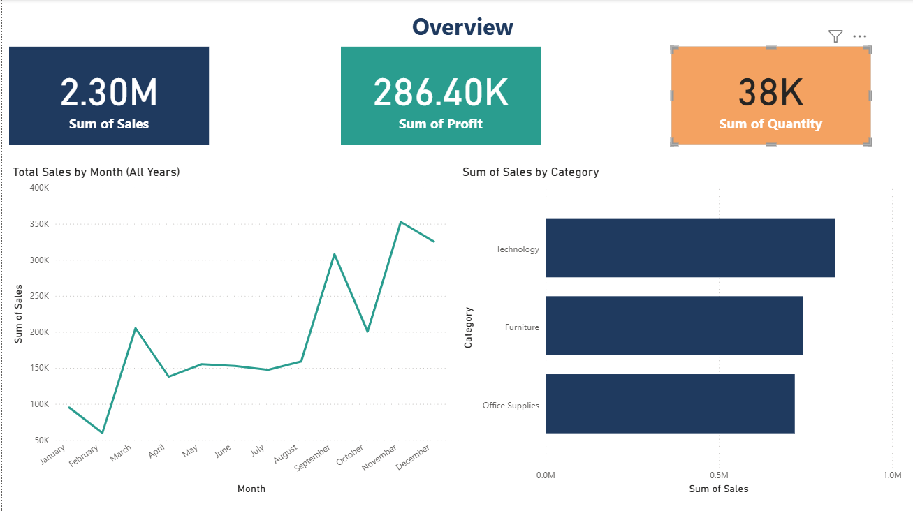
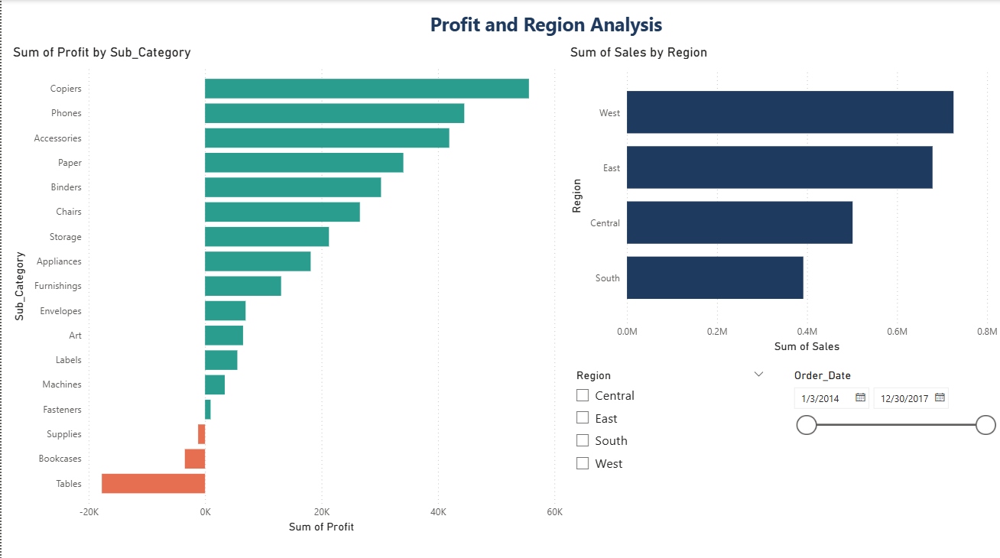

# Retail Sales Analysis Dashboard

An end-to-end analysis of a retail sales dataset (9,994 orders, 2014-2017) using Python, Excel and Power BI.

## Tools
- Python (pandas) for data cleaning and analysis
- Excel for summary tables
- Power BI for the interactive dashboard

## What I did
1. Cleaned the data: checked missing values and duplicates, converted date columns, and added Year, Month, Shipping Days and Profit Margin columns.
2. Created summary tables by region, category, sub-category, segment, state, year and discount band.
3. Built a 2-page Power BI dashboard with KPI cards, a monthly sales trend, and breakdowns by category, sub-category and region, with region and date slicers.

## Key findings
- Total sales: 2.30M | Total profit: 286.40K | Quantity sold: 38K
- Technology is the top-selling category.
- West has the highest sales and South the lowest.
- Tables, Bookcases and Supplies are loss-making sub-categories.
- Copiers, Phones and Accessories are the most profitable sub-categories.
- Monthly sales peak in the last months of the year.

## Dashboard preview

## Files
- `superstore_analysis.py`: cleaning and analysis script
- `superstore_cleaned.csv`: cleaned dataset
- `superstore_summary.xlsx`: summary tables
- `Superstore_Dashboard.pbix`: Power BI dashboard
- `insights.txt`: key numbers

## Data source
"Sample Superstore" dataset from Kaggle.
